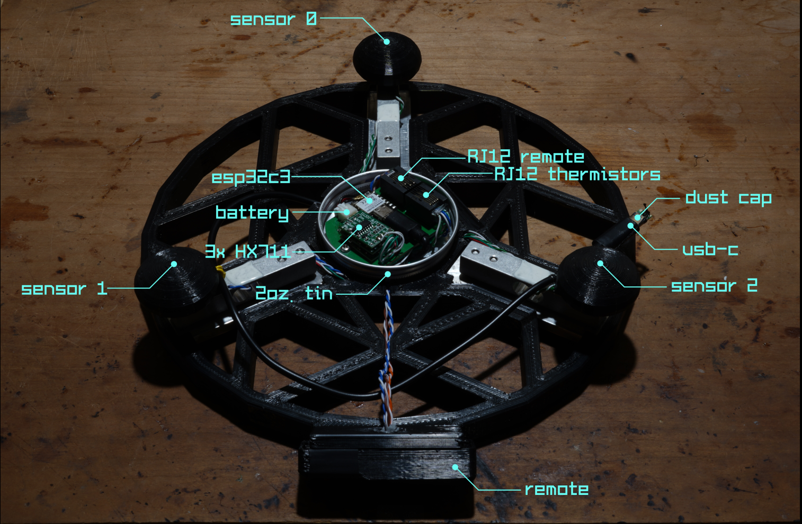

Growbies Owner's Manual
=======================
Welcome and we hope you enjoy your Growbies scale!

Growbies scales are built for growing.

If reading this manual online, please be sure the version matches that found on your scale at
`Configuration->Info->FW Version`.

.. _quick-start:

Quick Start
-----------
1. Place the scale under a containerized plant. That is, any plant growing in a pot, bag, etc.
2. Irrigate the plant to your desired growing-medium moisture level.
3. Zero one of the available tare values.
4. Monitor mass loss as the plant consumes water through transpiration and moisture evaporates.
5. Irrigate as needed, using the zero points as a reference and the real-time feedback from the
   built-in display for irrigation accuracy.

Zero the scale via ``Tare [A,B,C] -> Tare -> Zero``. Try not to disturb the scale while zeroing.

You, as the grower, know what soil moisture the plant needs. Setting the zero point of the scale
helps maintain the desired soil moisture. This is accomplished via

1. The zero point providing a quantitative reference to the grower
2. The built-in display feedback improving hand watering consistency and accuracy
3. Soil moisture telemetry as feedback in natural and automated irrigation contexts.

Design Features
---------------
Growbies scales are thermally calibrated. This allows accurate readings with varying temperature.
Each load cell is independently thermally calibrated using the per sensor temperature measurement.

These scales implement a summing load cell topology that allows for thermal isolation from the
frame. Each load cell is effectively an independent scale. This improves accuracy in rugged
environments.

The tripod footprint of the circular scales are inherently stable, in that, all three points will
touch in varied terrain without rocking.

When the scale is powered by the USB, there is an auto-wake feature that will wake the scale when
more than 50g of change in weight is detected. This feature is tunable via the gateway
``growbies nvm id`` command. Due to power constraints, this feature is not available when powered
by the battery.

Designed for indoor and outdoor growing environments. The scale is resistant to incidental dust and
water exposure, but is not waterproof. Avoid submerging the scale or exposing its electronics and
USB-C connector to standing water.

.. image:: _static/images/top_annotated.png

Specifications
--------------

10" circle scale
~~~~~~~~~~~~~~~~
- 30 kilogram (66 lb) capacity
- Operating temperature 0-120°F, 0-50°C
- Thermally calibrated
- Water-spray and dust resistant
- +/- 25g long-term accuracy [#longterm]_
- +/- 5g short-term accuracy [#shortterm]_
- USB-C serial communications via SLIP
- Open-source firmware and gateway (source)
- USB-C rechargeable battery

.. [#longterm] "Long-term" means the given accuracy over time and temperature.
.. [#shortterm] "Short-term" means the given accuracy at a fixed temperature
   and time period less than 10 minutes.

Built-in Display
----------------
The built-in display has three buttons; `up`, `down` and `select`. The menu is organized similar to
a file system tree. Select descends into the tree, returning to the top level when selecting past
the bottom.

The ``+`` character indicates there is more beneath the currently selected menu item that can be
accessed by pressing ``select``. The ``-`` character indicates that the associated menu item is
already accessed. The ``>`` character means that the leaf, or the bottom, of the tree has been
reached. Pressing ``select`` again will return to the top of the tree.

Map
~~~
.. code-block:: text

    ├── Tare A,B,C
    │   ├── Tare
    │   │   ├── Zero
    │   │   └── Cancel
    │   │
    │   ├── Units
    │   │   ├── g: grams
    │   │   ├── kg: kilograms
    │   │   ├── oz: ounces
    │   │   └── lb: pounds
    │   │
    │   ├── Error
    │   │   └── <error code>: <error description>
    │   │
    │   └── Load Cell 1-N
    │       ├── <mass value> <units>
    │       └── <error code>: <error description>
    │
    ├── Temperature
    │   ├── Units
    │   │   ├── C: Celsius
    │   │   └── F: Fahrenheit
    │   │
    │   ├── Error
    │   │   └── <error code>: <error description>
    │   │
    │   └── Load Cell 1-N
    │       ├── <temperature value> <units>
    │       └── <error code>: <error description>
    │
    └── Configuration
        │
        ├── Power
        │   ├── Sleep
        │   │   ├── True
        │   │   └── False
        │   │
        │   ├── Sleep TO (s)
        │   │   └── 0, 1, 2, 3, 5, 8, 15, 20, 30, 60, 90, 120, 240, 360, 480, 600, 1200
        │   │
        │   └── Battery
        │       ├── charging
        │       └── discharging
        │
        ├── Display
        │   ├── Flip
        │   │   ├── True
        │   │   └── False
        │   │
        │   └── Contrast
        │       └── 0-255
        │
        └── Info
            ├── Model No
            ├── FW Version
            ├── Source Hash
            ├── Mfg Date
            └── Serial No.

Definitions
~~~~~~~~~~~
- ``Tare A,B,C``: These are values that are subtracted from the absolute mass. These tare values map
  to points of interest in the real world. Such as, "the irrigate to" weight, the "empty scale"
  weight, they can be mapped to specific plants, the "too moist" and "too dry" points. The tare
  values can be zeroed to any point of interest by the grower.
- ``Tare A,B,C -> Tare -> Zero``: Set the zero point of the associated tare.
- ``Tare A,B,C -> Tare -> Cancel``: Cancel (do nothing) setting the zero point of the associated
  tare.
- ``Tare A,B,C -> Units``: Select the units for displaying mass.
- ``Tare A,B,C -> Error``: The current error state of the aggregate mass.
- ``Tare A,B,C -> Load Cell 1-N``: The per load cell mass as well as any error.

- ``Temperature``: The aggregate temperature of the scale. It is an average of the three load
  cell temperature measurements.
- ``Temperature -> Units``: Select the units for temperature display.
- ``Temperature -> Error``: The current error state of the aggregate temperature.
- ``Temperature -> Load cell 1-N``: The per load cell temperature and any associated error.

- ``Configuration``: System configuration and information menu.
- ``Configuration -> Power -> Sleep``: Selecting ``True`` will put the device into a low power sleep
  mode.
  Selecting ``False`` will cancel the request for sleep.
- ``Configuration -> Power -> Sleep TO (s)``: The sleep timeout in seconds. This is how many seconds
  the display will remain active before going to sleep. Button presses reset the timer. Jostling the
  scale beyond a 50 gram threshold will keep the scale awake. Setting this to zero will keep the
  scale awake always.
- ``Configuration -> Power -> Battery``: The charging state of the battery, either "charging" if the
  USB cable is plugged in or "discharging" when running on the battery alone.
- ``Configuration -> Display``: Display specific configuration menu
- ``Configuration -> Display -> Flip``: Flip the display over for left/right hand use. The built-in
  display can be physically flipped over to match.
- ``Configuration -> Display -> Contrast``: Turn the contrast up/down for the display. Lower values
  produce dimmer text; higher values produce greater contrast. The range of values is [0,255],
  inclusively.
- ``Configuration -> Info``: Information (read-only) menu
- ``Configuration -> info -> Model No.``: The model number.
- ``Configuration -> info -> FW Version``: The firmware version. Use this value to match the owner's
  manual version to ensure the docs match the firmware.
- ``Configuration -> info -> Source Hash``: The commit hash of the firmware.
- ``Configuration -> info -> Mfg Date``: The date of manufacture.
- ``Configuration -> info -> Serial No.``: The serial number of the device.

Use Cases
---------
Growbies scales are not intended to be a complete growing solution. Rather, they are intended to aid
the grower in their efforts. Here are some scenarios in which Growbies scales are useful. This is
not an exhaustive list.

Soil Moisture
~~~~~~~~~~~~~
Growbies does not directly measure volumetric soil moisture. Instead, it measures the total mass of
the containerized grow. Changes in mass provide a useful indication of water loss over time,
primarily through evaporation and transpiration.

As mentioned in the :ref:`Quick Start <quick-start>` section, Growbies provides a gravimetric
approach to providing the grower with a quantitative reference for insights into irrigation
demand and maintaining consistent growing conditions.

Place a containerized plant on the scale. Water it as desired. Zero the scale. Now the zero point is
a reference to the grower on the soil moisture state. Over time, the scale will read more and more
negative. This is the amount of water that has left the grow via evaporation and transpiration.

At the time of watering, the scale provides real-time feedback to the grower, allowing more accurate
irrigation. Additionally, because the mass is tracked over time, the grower can irrigate back to the
zero point that was set previously.

With this, irrigation stays tied to a quantitative soil moisture reference, represented by the zero
point of one of the provided Tare A, B or C.

The zero point can be set relative to the
:ref:`maximum container capacity <container-capacity>`. Some plants prefer consistent irrigation
closer to the maximum container capacity, while others prefer a drier growing medium.

.. _container-capacity:

Container Capacity
~~~~~~~~~~~~~~~~~~
The Growbies scale can help determine the container capacity of a growing medium. Container capacity
is the amount of water retained by the growing medium after excess water has drained away.

Irrigate the plant until water begins to drain from the bottom of the container. Allow drainage to
finish, then record the mass displayed by the scale. This represents the mass of the containerized
grow at container capacity.

Note, the container capacity can vary depending on the history of irrigation. e.g. dry soil is
hydrophobic, whereas soil that has been kept relatively moist over time will retain more moisture.

This gives the grower a useful reference point for establishing irrigation targets.

General Purpose
~~~~~~~~~~~~~~~
- measure harvests
- weigh out dry soil when potting
- weigh homogeneous growing containers to ensure consistency across the batch. For example, if
  growing pepper plants, each in a container, each can be placed on the scale and irrigated
  consistently across all of them.

Gateway
-------
Remove the dust cap and connect the scale to a Growbies gateway via the provided USB-A to USB-C
cable. This provides programmatic access to the device. For more detailed information, including
information regarding valuable insights provided by time tracking the weight of a grow, please see
`Gateway Documentation <../gateway/index.html>`_ .

Care and Maintenance
--------------------
- Charge the device via the USB-C port. The expected battery life is 2-3 months with daily use.
- Growbies scales are a calibrated scientific instrument and should be handled with care.
- Do not drop the scale.
- Be sure to install the dust cap, clean and dry, when not connected to USB.
- The load cells are mounted to the frame in a loosely coupled way so that reproducibility is
  improved when moving the scale from place to place. Be sure there is no binding when placing the
  scale by gently moving the scale around until the measured weight settles.
- Avoid direct sunlight on the display. This can damage the display in the long term and it makes it
  difficult ot read
- Avoid leaving the scale directly in the sun with nothing on it. The ultra-violet radiation can
  cause premature aging.
- Do not exceed the maximum weight
- Do not exceed temperature constraints

Troubleshooting
---------------
- Inconsistent mass readings
    - Check for an error state on the built-in display at ``Tare A,B,C -> Error`` and 
      ``Tare A,B,C -> Load Cell 1-N`` -> contact Growbies on error
    - Check for an error state on the built-in display at ``Temperature -> Error`` and 
      ``Temperature -> Load Cell 1-N`` -> contact Growbies on error . Because the mass is a function
      of temperature, the will affect the final output mass.
- Blank display
    - Charge the battery via the USB-C cable
- Lost in the menu. Sometimes buttons are pressed inadvertently. In this case, just press select
  and/or up/down to work through the menu tree, returning to the top of the menu after the last
  level is selected.

Contact Information
-------------------
Eric Meyer, Founder

email: support@growbies.net

phone: 720-308-1313

Please provide your Growbies model number, firmware version and serial number, if possible.
