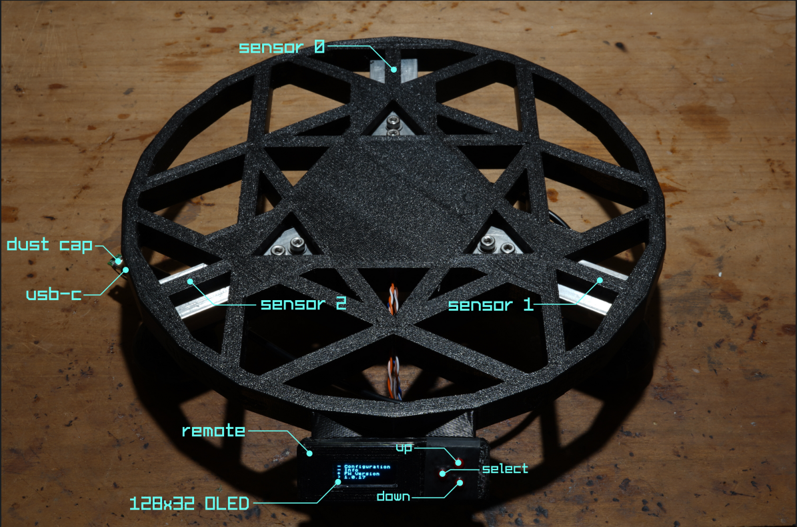

Owner's Manual
==============
Welcome and we hope you enjoy your Growbies scale!

Growbies scales are built for growing.

1. Place the scale under a containerized plant. That is, any plant growing in a pot, bag, etc.
2. Zero the scale at a soil moisture weight of interest.
3. Irrigate back to zero, returning the amount of water that has evaporated and transpired.

You, as the grower, know what soil moisture the plant needs. Setting the zero point of the scale
helps maintain the desired soil moisture. This is accomplished via

1. The zero point providing a quantitative reference to the grower
2. The builtin display feedback improving hand watering consistency and accuracy
3. Soil moisture telemetry as feedback in natural and automated irrigation contexts.

If reading this manaul online, please be sure the version matches that found on your scale at
`Configuration->Info->FW Version`.

Design Features
---------------
Growbies scales are thermally calibrated. This allows accurate readings with varying temperature.
Each load cell is independently thermally calibrated and measured.

These scales implement a summing load cell topology that allows for thermal isolation from the
frame. Each load cell is effectively a scale by itself. This improves accuracy in rugged
environments.

The tripod footprint of the circular scales are inherently stable, in that, all three points will
touch in varied terrain without rocking.

For indoor/outdoor use. Water spray and dust resistant.

